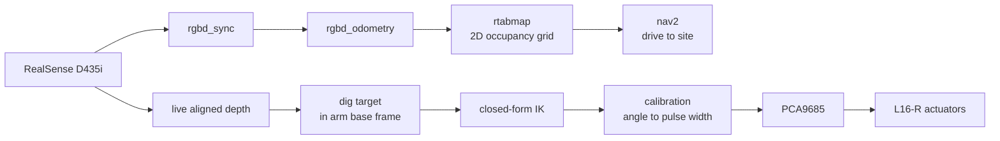

# Mining Automation Lab

An autonomous mining excavator built on a Jetson Orin Nano. A RealSense D435i locates a
limestone face, closed-form inverse kinematics turns a dig point into joint angles, and
LSS smart servos plus RC linear actuators execute the dig cycle.

[View on GitHub](https://github.com/samuelp4065/mining-automation-lab){: .btn .btn-primary }

---

## What the machine does

A tracked excavator that drives itself to a work site, finds a rock face, and digs.

The codebase is a **ROS 2 Humble workspace** holding all first-party code, built as an
overlay on a separate workspace carrying third-party sources (librealsense, realsense-ros,
rtabmap). That split is deliberate: rebuilding this project must never trigger a
multi-hour third-party compile.

## The one architectural rule

**Drive from the map, dig from the live frame.**

The SLAM occupancy grid is downsampled and accumulates drift. That is fine for planning a
path across a site and useless for placing a bucket to the centimetre. Dig targets come
from the live aligned depth frame transformed into the arm base frame — never from the map.

## Where to start

| Page | What's in it |
|---|---|
| [Hardware](hardware) | Servo bus, actuators, power, wiring |
| [Actuation](actuators) | PWM generation, the PCA9685 migration, control interface |
| [Kinematics](kinematics) | The closed-form arm solve and calibration |
| [Perception](perception) | SLAM, navigation, the proximity interlock |
| [Software](software) | Package layout, nodes, build and run |

## Current state

| Subsystem | State |
|---|---|
| Arm kinematics | Working — 32 tests passing, no hardware needed |
| Actuator control | Working through the PCA9685, motion confirmed |
| Track drive and odometry | Working; RPM-per-m/s scale factor uncalibrated |
| SLAM and mapping | Working; no IMU fusion yet |
| Proximity interlock | Working, with a synthetic depth source for testing |
| Bucket calibration | **Open** — convention mismatch, needs one measurement |
| Autonomous dig cycle | **Open** — a working sequence exists but is time-sequenced with no completion feedback |
