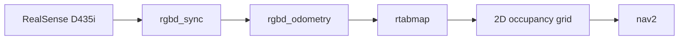

# Perception and navigation

---

## The SLAM pipeline

The bringup launch runs:



Configured with `Reg/Force3DoF=true` and `Grid/3D=false`, which yields a 2D occupancy
grid. That is the correct representation for a tracked vehicle, and it is what nav2 can
plan on.

```bash
ros2 launch excavator_bringup full_launch.py
```

---

## Drive from the map, dig from the live frame

This is the one architectural rule worth repeating.

The RTAB-Map occupancy grid is **downsampled and drift-accumulating**. That is acceptable
for planning a route across a work site. It is not acceptable for placing a bucket.

Dig targets are extracted by transforming the **live aligned depth frame** into the arm
base frame and slicing the working plane. The map is never consulted for a dig point.

---

## Proximity interlock

A proximity monitor sits between teleop and the drive, stopping the machine when the depth
camera sees an obstacle inside a threshold.

```bash
ros2 launch excavator_bringup proximity_drive.launch.py
```

It ships with a synthetic depth source (`fake_depth`), so the interlock logic can be
exercised without a camera or a machine.

---

## Mapping a known site

For sites whose shape is already known, an occupancy map can be authored directly rather
than driven and built:

```bash
python3 tools/mapping/occupancy_map.py
```

It supports polygon boundaries for irregular, L-shaped sites, and emits a nav2-compatible
map.

---

## Known gap: odometry

{: .warning }
> `rgbd_odometry` is the **only** odometry source, and the D435i's IMU is not enabled.
> Pure visual odometry is fragile exactly where this machine operates: a vibrating tracked
> chassis, skid-steer rotation, and a low-texture rock face. `imu_filter_madgwick` is
> installed and declared in the bringup package's manifest but is not yet wired into the
> launch.

Wiring the IMU into the odometry chain is the highest-value perception work outstanding.

---

## Track odometry

Wheel odometry is integrated from the LSS servo encoders, inverting the same skid-steer
mixing that the drive node applies. Both import their geometry and sign conventions from
`drive_config.py` so they cannot disagree.

{: .note }
> The RPM-per-metre-per-second scale factor is **not yet calibrated**. It depends on drive
> sprocket diameter and gearing, so it cannot be derived — the machine has to drive a known
> distance at a known command. Until then every velocity in m/s is proportionally correct
> but not absolutely correct.
